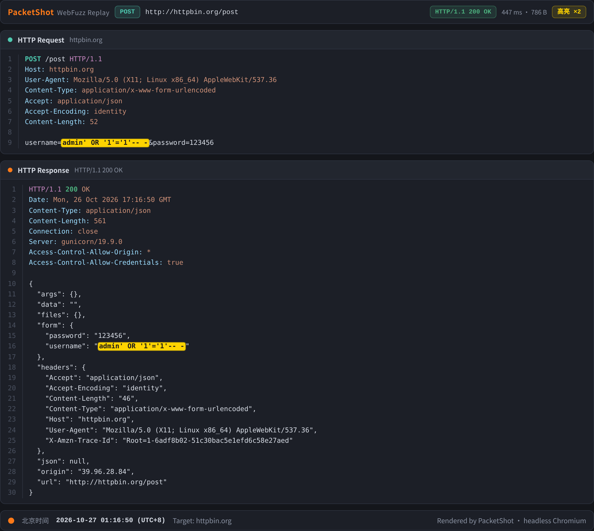

# PacketShot —— Agent 渲染发包截图

把「全链哨兵」文章里的 **Agent 渲染发包截图** 思路提取出来的独立实现：
不依赖 Burp / Yakit 等客户端，内置 Web 页面渲染数据包，无头浏览器截图，
可选真实重放请求，自动带 **北京时间** 水印，支持 **payload 高亮**。
专为渗透测试 / 攻防演练报告场景设计。



## 特性

- **Burp 风格渲染**：行号、语法着色（方法/头部/状态码/请求行分色）
- **真实发包**：`--send` 用原始 socket 重放请求，截图中的响应是真实返回
- **北京时间水印**：页脚固定 UTC+8，交报告直接可用
- **payload 高亮**：`--hl` 指定字符串或正则，命中处黄色标记，并统计命中数
- **零客户端依赖**：Python + Playwright + Chromium
- **Agent 友好**：stdout 只输出 PNG 路径；详见 [AGENTS.md](AGENTS.md)

## 安装

```bash
git clone <本仓库地址> packetshot && cd packetshot
pip install .                                  # 安装 packetshot 命令
python -m playwright install chromium          # 首次需下载浏览器内核
```

已有 Chromium 内核的环境可跳过最后一步。也可以不安装，直接运行
`python3 packetshot.py ...` 或 `python3 -m packetshot ...`。

## 快速开始

```bash
# 已有请求+响应文件，直接渲染
packetshot --req examples/sqli-req.txt --resp examples/sqli-resp.txt \
           --hl "admin' OR '1'='1'-- -,login success" -o out/demo-sqli.png

# 真实重放后截图（响应来自真实目标，不是编造数据）
packetshot --req examples/live-post-req.txt --send \
           --hl "admin' OR '1'='1'-- -" -o out/demo-live.png
```

生成的 `out/demo-live.png` 即本文顶部效果图。

## 参数

| 参数 | 说明 |
|---|---|
| `--req PATH` | 原始请求文件（Burp `Copy to file` 格式），`-` 读 stdin |
| `--resp PATH` | 原始响应文件（与 `--send` 二选一） |
| `--send` | 真实重放请求，用真实响应渲染 |
| `--scheme http\|https` | 重放协议，默认按 Host 端口猜测（443→https） |
| `--hl "a,b"` | 高亮字符串，逗号分隔，可重复；命中数显示在工具栏 |
| `--hl-regex` | 把 `--hl` 当正则用 |
| `--title` | 左上角标题（默认 PacketShot） |
| `-o PATH` | 输出 PNG（默认 `packetshot-<时间戳>.png`） |
| `--width` | 渲染宽度，默认 1180 |
| `--timeout` | 重放超时秒数，默认 15 |

## 行为说明

- **北京时间**：页脚固定显示 UTC+8 时间，攻防演练交报告直接可用。
- **Content-Length 自动修正**：粘贴的请求体经常和头部不符，重放时按真实
  body 重算（与 Burp Repeater 行为一致），避免服务端挂起。
- **Connection: close**：重放时强制 close，读完全部原始响应字节，
  截图里是未经解码的 raw response（chunked 也原样展示）。
- **TLS 证书**：默认忽略校验（自签/通配失配的内网站点常见）。
- **高亮实现**：先按语法分段（请求行/状态行/头部/body），段内再切高亮词，
  不存在 HTML 注入错位问题；高亮词自动做正则转义。
- **未编码 payload**：请求行允许带空格（如 `GET /a?id=1 UNION SELECT 1`），
  原样发包时目标可能返回 400，属真实现象；需要 200 请用编码后的 payload。

## 目录结构

```
packetshot/
├── packetshot/            # Python 包
│   ├── cli.py             # 解析 / 重放 / 截图
│   ├── viewer.html        # Burp 风格渲染页（含北京时间页脚）
│   ├── __main__.py        # python -m packetshot
│   └── __init__.py
├── packetshot.py          # 兼容入口（未安装时直跑）
├── examples/              # 示例数据包
├── docs/screenshot.png    # 效果图
├── AGENTS.md              # 给其他智能体的使用说明
├── pyproject.toml
└── LICENSE
```

## Agent 集成

其他智能体拉取本仓库后，按 [AGENTS.md](AGENTS.md) 调用即可：
挖到漏洞 → 数据包落盘 → 一条命令出图 → stdout 最后一行即 PNG 路径。

```bash
cat > /tmp/vuln-req.txt <<'EOF'
POST /api/login HTTP/1.1
Host: target.com
Content-Type: application/x-www-form-urlencoded

username=admin'-- -&password=x
EOF

OUT=$(packetshot --req /tmp/vuln-req.txt --send \
      --hl "admin'-- -" -o /tmp/vuln-shot.png | tail -n1)
echo "$OUT"   # /tmp/vuln-shot.png
```

## 开发

```bash
pip install -e .
python3 -m packetshot --req examples/sqli-req.txt \
        --resp examples/sqli-resp.txt -o /tmp/test.png
```

## 免责声明

仅限**获得授权**的安全测试、攻防演练与教学场景使用。
使用者须自行确保测试行为合法合规，并承担相应责任。
